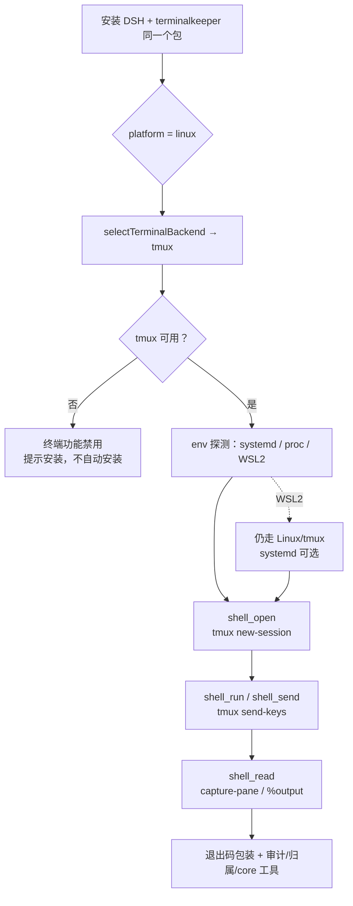
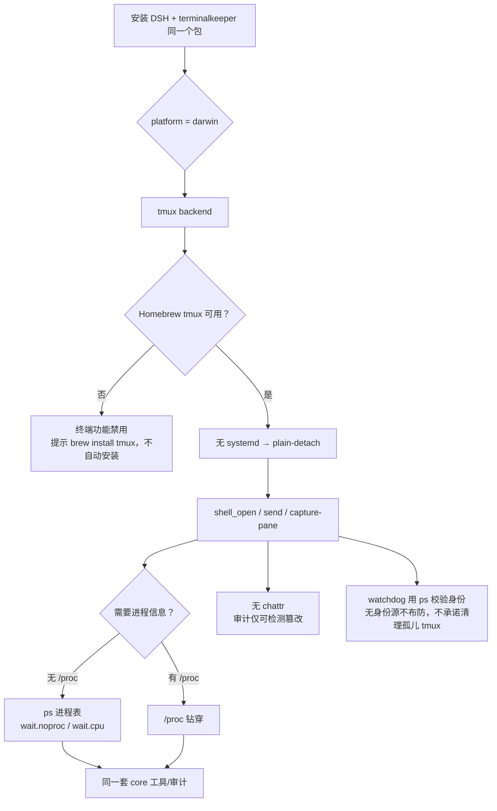
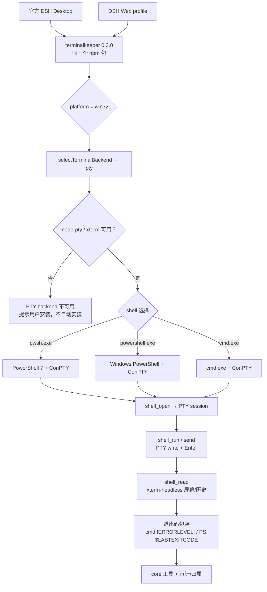

# terminalkeeper 三平台流程图

> 同一个 npm 包 `terminalkeeper-0.3.0.tgz`；平台差异只在运行时选择 backend。
> 状态：Linux/WSL2 与 Windows 已做真实调用验证；macOS 只有契约测试，没有实机；macOS watchdog 用 `ps` 校验进程身份，没有可用身份源时只报告、不布防。

## Linux / WSL2

## macOS

## Windows

## 共享约定

- **客户端 UI 共用**：面板和软键盘都是浏览器 UI；软键盘通过 portal 挂到页面根节点，不随终端面板的 `overflow` 裁切，键面布局与平台无关。

- **一个包**：Linux / macOS / Windows 共用一个 `terminalkeeper` npm 包；不按平台拆三个安装包。
- **外部程序不代装**：tmux、PowerShell、node-pty、xterm 缺失时只提示/禁用对应功能。
- **core 不感知平台**：锁、归属、审计、vault、宏、工作区都留在 core；backend 只负责终端机制。
